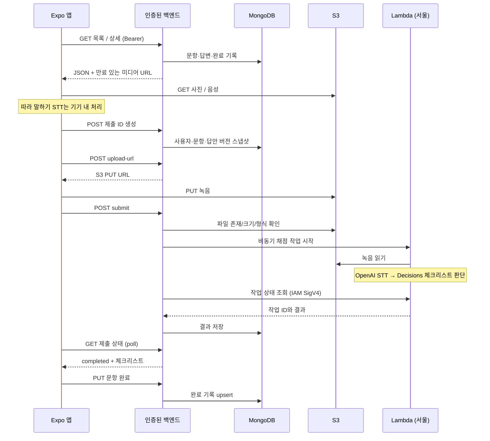

# 답변 익히기 API 계약 v1

**상태: 프론트 구현 및 테스트 Learning Core 배포 완료(2026-10-13, backend PR #36). 운영 서버 배포는 별도다.**
프론트와 백엔드는 이 계약을 그대로 사용한다. 전달 후 담당자가 필드나 경로를 추측해서 변경할 필요가 없다. 현재 합류 조건은 [릴리스 인수인계](../answer-learning-release.md)를 따른다.
[인수인계 시작점](../answer-learning-handoff.md) · [모든 파트의 예시 JSON](answer-learning-examples.json)

## 경계와 인증



이 브랜치에서는 녹음 전송을 **백엔드 발급 URL로 앱→S3 직접 PUT**으로 설계했다.
백엔드가 원본 파일을 대신 받아 S3에 저장하던 로컬 테스트 방식과 달라진 부분이다. 전송을 중계하지 않아도 백엔드가 파일 소유권과 채점 시작을 통제할 수 있다.
S3 업로드만으로 자동 채점을 시작하지 않는다. `/submit`이 검증 후 작업을 시작한다. 향후 S3 이벤트 방식을 쓰면 같은 제출 ID에 대한 중복 방지 잠금을 공유해야 한다.

- Base: 기존 `EXPO_PUBLIC_LEARNING_API_BASE_URL`, HTTPS. 접두사 `/api/v1/learning`.
- JSON API는 기존 앱의 Bearer 세션 인증을 사용한다. userId를 body/query에서 받지 않고 인증 주체에서 결정한다.
- 앱은 AWS 키, OpenAI 키, Lambda URL, MongoDB 접속 정보를 갖지 않는다. 모델 호출은 서버만 담당한다.
- S3 요청에는 앱 Bearer를 보내지 않는다. 백엔드가 발급한 URL과 `Content-Type`만 보낸다.
- 모든 JSON 응답은 기존 공통 envelope를 유지한다.

```json
{ "isSuccess": true, "code": "SUCCESS", "message": "성공", "result": {} }
```

오류 예:

```json
{
  "isSuccess": false,
  "code": "CHECKLIST_NOT_READY",
  "message": "이 문항의 채점을 준비하고 있어요.",
  "result": { "retryable": false }
}
```

## 엔드포인트 목록

| 메서드 | 경로 (접두사 뒤)                    | 프론트 호출 시점                    | result                              |
| ------ | ----------------------------------- | ----------------------------------- | ----------------------------------- |
| GET    | `/units?part=2&level=IM3`           | 학습 홈·파트/등급 변경·새로고침     | 파트/등급별 카드 요약과 완료 상태   |
| GET    | `/units/{unitId}?level=IH`          | 카드에서 시작                       | 세트와 선택 등급의 문항·답변·미디어 |
| GET    | `/media/{mediaId}/url`              | 미디어 URL 만료/재생 실패 후 재시도 | 갱신된 GET URL                      |
| GET    | `/capabilities?lessonId={lessonId}` | Part 2~5 세션 진입                  | 채점 준비 상태                      |
| POST   | `/submissions`                      | 답변 제출                           | 생성 또는 기존 작업                 |
| POST   | `/submissions/{id}/upload-url`      | 작업이 awaiting_audio               | S3 PUT URL                          |
| POST   | `/submissions/{id}/submit`          | S3 PUT 성공 후                      | queued 또는 기존 작업               |
| GET    | `/submissions/{id}`                 | 제출 후 약 1.2초 간격·대기 재개     | 작업 상태/결과                      |
| POST   | `/submissions/{id}/retry`           | 실패 후 사용자가 다시 제출          | 재시도된 작업                       |
| PUT    | `/lessons/{lessonId}/completion`    | 비교/채점 완료                      | 저장된 완료 정보                    |

## 1. 목록

`GET /units?part=2&level=IM3`

- `part`: 1~5. `level`: `common`, `IM3`, `IH`, `AL`. 화면 IM=API IM3.
- Part 1 목록은 항상 `common`. 다른 파트에 common은 400.
- **단일 파트 최대 100개 요약을 전부 반환하는 v1 계약이다. 현재 목표는 파트별 40개. 페이지네이션 없음.**
  100개를 넘기기 전에 cursor 계약과 목록 코드를 같이 개정한다. 답변·본문·음성 전체를 목록에 실어 보내지 않는다.

```json
{
  "part": 2,
  "level": "IM3",
  "units": [
    {
      "id": "example-unit-p2",
      "part": 2,
      "title": "도서관 풍경",
      "thumbnail": {
        "id": "photo-1",
        "url": "https://media.example.com/photo.png",
        "expiresAt": "2099-01-01T00:00:00Z",
        "width": 1200,
        "height": 800
      },
      "lessons": [{ "id": "example-p2-q3", "questionNumber": 3, "completed": false }]
    }
  ]
}
```

- Part 1·2·5는 카드당 1문항. Part 3는 Q5/6/7, Part 4는 Q8/9/10을 순서대로 3문항.
- 제목은 짧은 한국어 키워드 중심. 프론트는 한 줄 말줄임을 사용한다.
- `thumbnail`은 없으면 null. `completed`는 요청 등급 + 현재 콘텐츠 버전 + 현재 사용자 기준이다.
- 프론트가 모든 하위 문항이 완료된 카드를 완료로 계산하고 아래로 이동한다. 일부만 완료한 세트는 `1/3 완료`로 보인다.
- 서버 원래 순서는 변경되지 않는 `sortOrder`를 기준으로 유지한다. 새로 조회했을 때 임의로 섞지 않는다.

## 2. 상세

`GET /units/{unitId}?level=IH`

`result`는 `{unit, lessons}`. unit은 위 요약과 같은 형식. lessons는 **unit.lessons와 동일한 ID/순서**의 본문이다.
Part 1 상세는 어떤 level이 요청되어도 common 답변을 반환한다. Part 2~5는 요청한 level 한 개만 반환한다.

| lesson 필드                 | 형식/의미                                                   |
| --------------------------- | ----------------------------------------------------------- |
| id, contentVersion          | 비어 있지 않은 문자열. 수정된 문제/답안/타이밍은 새 버전    |
| part, questionNumber        | 파트 번호, 실제 문항 번호                                   |
| question                    | 영어 질문. Part 2 UI에서는 사진 아래 중복 지시문을 생략     |
| questionTranslation         | 한국어 질문 해석, 선택 필드                                 |
| passage, passageTranslation | Part 1 읽기 지문, 해석. passage는 다른 파트에서 null        |
| answerSeconds               | 15~60 정수. 실전 녹음 제한, 따라 말하기 제한 시간이 아님    |
| photo                       | Part 2 필수, 나머지 null. media + width/height              |
| contextIntro                | 세트 상황 설명 문자열 또는 null                             |
| table, tableFocus           | Part 4 전체 표와 해당 질문에 필요한 발췌 표, 다른 파트 null |
| level                       | Part 1 common, 나머지는 선택한 IM3/IH/AL                    |
| answer                      | 선택된 수준의 모범답안                                      |

```json
{
  "id": "answer-q3-ih-v1",
  "example": "A person is reading a book.",
  "fullAudio": {
    "id": "audio-full",
    "url": "https://media.example.com/full.m4a",
    "expiresAt": "2099-01-01T00:00:00Z"
  },
  "durationSeconds": 10,
  "sentences": [
    {
      "text": "A person is reading a book.",
      "translation": "한 사람이 책을 읽고 있습니다.",
      "label": "주요 장면",
      "audio": {
        "id": "audio-sentence-1",
        "url": "https://media.example.com/s1.m4a",
        "expiresAt": "2099-01-01T00:00:00Z"
      },
      "words": [
        { "text": "A", "start": 0, "end": 0.2 },
        { "text": "person", "start": 0.25, "end": 0.6 },
        { "text": "is", "start": 0.65, "end": 0.8 },
        { "text": "reading", "start": 0.85, "end": 1.2 },
        { "text": "a", "start": 1.25, "end": 1.35 },
        { "text": "book.", "start": 1.4, "end": 1.8 }
      ]
    }
  ]
}
```

- sentences는 비어 있으면 안 된다. 문장들을 공백으로 연결하면 example과 일치해야 한다.
- words.text를 공백으로 연결하면 해당 text와 일치해야 한다. 구두점 포함. 시간 단위는 **초, 각 문장 파일 시작 기준**이다.
- start/end는 유한한 0 이상 숫자이며 end>=start, start는 순서대로 증가한다.
- 이미 만들어 둔 음성/정렬 타임스탬프를 반환한다. 읽기 때마다 TTS/STT로 새로 만들지 않는다.
- Part 1은 fullAudio 필수. 실전 뒤 모범 지문과 본인 녹음을 전환 재생한다.
- 번역이 없으면 해당 해석을 표시하지 않는다. 프론트에서 번역 API를 호출하지 않는다.

### Part 4 표

기존 앱 `ExamTableContext`와 동일한 camelCase 필드다.

```json
{
  "tableType": "schedule",
  "title": "Workshop",
  "subtitles": [],
  "metadata": [{ "key": "date", "label": "Date", "value": "October 20" }],
  "columns": [
    { "key": "time", "label": "Time", "valueType": "text" },
    { "key": "session", "label": "Session", "valueType": "text" }
  ],
  "items": [
    {
      "cells": { "time": "9:00 a.m.", "session": "Welcome" },
      "status": "scheduled",
      "statusNote": null,
      "strikeThrough": false
    }
  ],
  "notes": []
}
```

`tableFocus`는 서버에서 미리 지정한 행/열/메타데이터/각주만 포함한다. 모델로 실시간 발췌하지 않는다.
전체 표에서 값을 바꾸지 않고 골라서 내려준다. Q8이 금액/장소 등의 metadata만 묻는 경우 columns/items가 빈 배열이어도 된다.
프론트는 요약 카드를 위에 표시하고 전체 표 보기를 누르면 full table을 별도 화면으로 연다.

## 3. S3 읽기 URL

미디어 공통 필드는 `{id,url,expiresAt}`. 사진은 여기에 실제 원본 width/height를 추가한다.
`expiresAt`은 UTC/오프셋을 포함한 ISO 8601 문자열, URL은 HTTPS. 앱은 URL을 장기 저장하지 않는다.
권장 유효기간은 GET 60분 이상, PUT 5분. DB에는 URL이 아니라 media ID와 S3 key를 저장한다.

`GET /media/{mediaId}/url` → `{id,url,expiresAt}`. 백엔드는 현재 사용자가 접근 가능한 학습 미디어인지 확인한다.
다른 ID로 바뀌면 프론트가 거절한다. 오디오는 만료 60초 전부터 갱신하고 재생 실패 후 재시도 시 새 주소를 받는다.
사진은 만료/로드 실패 시 한 번 갱신한다. 오디오 Range GET과 올바른 Content-Type을 S3/CloudFront에서 제공한다.
웹까지 제공하면 별도 CORS 설정이 필요하며 iOS/Android만 검증했다고 웹 업로드가 된다고 가정하지 않는다.

## 4. 채점 가능 여부

`GET /capabilities?lessonId=example-p2-q3`

```json
{ "ready": true, "lessonIds": ["example-p2-q3"] }
```

- 해당 문항에 현재 버전의 체크리스트가 없으면 `lessonIds:[]`.
- 체크리스트는 있으나 STT/판단 처리가 불가능하면 ready=false.
- 사용자 요청량 한도를 초과하면 429. 단순 health/readiness 요청은 STT/판단 모델을 호출하지 않는다.
- Part 1은 이 API를 호출하지 않는다. 실제 토스 점수/발음 점수로 표현하지 않는다.

## 5. 제출 생성

`POST /submissions`

```json
{
  "submissionId": "d11aa316-35be-4e49-b681-19a35d2c7bce",
  "lessonId": "example-p2-q3",
  "level": "IM3",
  "contentVersion": "example-v1"
}
```

프론트가 녹음마다 UUID를 만든다. **동일한 녹음의 재전송에는 같은 ID를 쓴다.**
백엔드는 사용자+submissionId를 고유키로 처리한다. 기존 ID/동일 본문이면 기존 작업을 반환하고 다시 채점하지 않는다.
같은 ID에 다른 문항/등급/버전이면 409. 현재 콘텐츠와 버전이 다르면 `CONTENT_VERSION_CHANGED` 409.
Part 1 제출은 400. 지원하지 않는 체크리스트는 `CHECKLIST_NOT_READY` 409.
질문/모범답안/체크리스트는 클라이언트 body를 신뢰하지 않고 DB에서 읽어 스냅샷한다.

```json
{
  "id": "d11aa316-35be-4e49-b681-19a35d2c7bce",
  "lessonId": "example-p2-q3",
  "contentVersion": "example-v1",
  "level": "IM3",
  "status": "awaiting_audio",
  "result": null,
  "error": null
}
```

## 6. 업로드와 처리 시작

`POST /submissions/{id}/upload-url`

```json
{ "contentType": "audio/mp4", "sizeBytes": 250000 }
```

```json
{
  "submissionId": "d11aa316-35be-4e49-b681-19a35d2c7bce",
  "url": "https://upload.example.com/recording.m4a?signature=EXAMPLE",
  "expiresAt": "2099-01-01T00:00:00Z",
  "maxBytes": 8388608
}
```

- 앱은 해당 URL로 m4a/AAC 파일을 binary PUT한다. multipart/form-data, JSON, base64가 아니다.
- Content-Type은 정확히 `audio/mp4`. URL 발급 시 이 헤더로 서명한다. 별도 AWS/IAM 헤더를 프론트에 요구하지 않는다.
- 최대 8 MiB. 서버가 실제 파일 크기/디코딩 가능 여부/3초 이상~문항 제한+여유 시간/음성 형식을 검증한다.
- URL은 현재 사용자의 해당 awaiting_audio 작업에만 발급한다. S3 key는 서버가 결정한다.
- 제출 시작 이후 파일을 바꿀 수 없도록 S3 versionId를 고정해 worker에 넘기거나 입력을 별도 immutable key로 복사한다. 남은 PUT URL의 덮어쓰기가 진행 중인 채점에 영향을 주면 안 된다.

S3 PUT 성공 후 `POST /submissions/{id}/submit`, body `{}`.
백엔드는 S3 객체를 확인하고 원자적으로 awaiting_audio→queued 전환한 뒤 작업을 dispatch한다. 응답은 같은 job 형식이다.
반복 submit은 현재 job만 반환한다. dispatch 실패는 outbox/queue 재전달로 복구하고 유실된 queued 작업을 방치하지 않는다.
앱이 PUT 응답을 잃으면 같은 제출 ID로 조회/업로드/confirm을 재개할 수 있다. 불확실한 모델 타임아웃에서 자동 새 제출을 만들지 않는다.

## 7. 상태 조회와 결과

`GET /submissions/{id}`. 항상 같은 소유자 권한 검증. 다른 사용자의 ID는 404.

`awaiting_audio → queued → transcribing → grading → completed`, 실패는 `failed` 또는 `no_speech`.
프론트는 약 1.2초마다 최대 150초 기다린다. 그 뒤 사용자가 결과 확인을 재개하면 기존 ID를 조회한다.
앱의 대기 중단/백그라운드 종료가 서버 작업 취소를 의미하지 않는다.

완료 result:

```json
{
  "checklistVersion": "example-v1",
  "transcript": "A person is reading a book.",
  "metCount": 1,
  "totalCount": 2,
  "items": [
    {
      "id": "action",
      "label": "주요 행동 묘사",
      "verdict": "met",
      "probability": 0.94,
      "feedback": "행동을 설명했어요."
    },
    {
      "id": "background",
      "label": "배경 묘사",
      "verdict": "not_met",
      "probability": 0.12,
      "feedback": "배경도 한 문장 덧붙여 보세요."
    }
  ]
}
```

- verdict: met/not_met/uncertain. probability: 유한한 0~1 숫자. uncertain은 미달로 단정하지 않는다.
- totalCount=items.length, metCount=met 항목 수. item id 중복 불가. 프론트도 검증한다.
- completed는 result 필수, failed는 error 필수. error는 `{code,message,retryable}`.
- no_speech는 재녹음 안내. 판단 모델 오류를 0점 결과로 바꾸지 않는다.
- 문장/질문/등급/버전/작업 ID를 응답에서 재확인한다. 다른 문항 결과는 화면에 반영하지 않는다.
- 전사 텍스트는 결과 펼치기에서 표시한다. 로그/분석 이벤트에 녹음 URL·전사·문제 원문을 남기지 않는다.
- 문항별 체크리스트는 MongoDB에서 사전 준비한다. Lambda는 STT와 OpenAI Decisions 판단을 수행하고 백엔드가 저장한다. 공식 토스 등급 점수가 아니다.

`POST /submissions/{id}/retry`, body `{}`: 사용자가 실패 후 다시 제출한 경우에만 호출한다.
서버가 재시도 가능 여부/횟수를 판단한다. 이미 성공했거나 처리 중이면 기존 job 반환. 재시도 횟수는 서버에서 제한한다.
판단 단계만 실패했다면 저장된 전사를 재사용해 STT를 중복 청구하지 않는다. API 응답 유실과 실제 처리 실패를 구분한다.

## 8. 완료 기록

`PUT /lessons/{lessonId}/completion`

```json
{
  "level": "IM3",
  "contentVersion": "example-v1",
  "submissionId": "d11aa316-35be-4e49-b681-19a35d2c7bce"
}
```

Part 1은 `{"level":"common","contentVersion":"example-v1"}`이며 제출 ID가 없다.
Part 2~5는 동일 사용자/문항/등급/버전의 completed 제출인지 서버에서 확인한다.
반환: `{lessonId,level,contentVersion,completed:true}`. 반복 PUT은 안전한 upsert다.
완료는 학습 종료 여부이며 체크리스트 만점 여부가 아니다. 재생 위치/인식 토큰은 보내지 않는다.
저장 성공 후 목록 캐시를 갱신한다. 실패는 세션에 다시 저장 버튼을 표시하며 저장 성공으로 가장하지 않는다.
Part 2~5의 채점 완료와 완료 upsert를 서버에서 한 트랜잭션으로 처리하면 앱 종료 직전 네트워크 유실에도 복구할 수 있다.

## MongoDB/S3 권장 분리

| 컬렉션/저장소        | 내용/키                                                                                  |
| -------------------- | ---------------------------------------------------------------------------------------- |
| learning_units       | `_id`, part, title, sortOrder, lessonIds, thumbnailMediaId, publicationStatus            |
| learning_lessons     | `_id`, unitId, questionNumber, contentVersion, 질문/번역/지문, media ID, 전체/발췌 표    |
| learning_answers     | lessonId + level + contentVersion unique, 문장/번역/word timings, audio media IDs        |
| learning_checklists  | lessonId + contentVersion + checklistVersion unique, 파트별 판정 조건/피드백             |
| learning_media       | mediaId unique, S3 bucket/key/versionId, MIME, width/height/duration, 접근 범위          |
| learning_submissions | userId + submissionId unique, lesson/level/version, 상태, 파일 버전, 전사, 결과, 시도 수 |
| learning_completions | userId + lessonId + level + contentVersion unique, completedAt                           |
| S3                   | 모범 음성·사진과 사용자 녹음을 별도 prefix/권한/보관 기간으로 분리                       |

문제은행의 출판된 모의고사 중복 여부는 서버 콘텐츠 선정 시 관리한다. 앱에서 문제은행 전체를 다운로드해 필터링하지 않는다.
원본 오디오/사진은 Git/앱 번들에 넣지 않는다. URL은 요청 시 발급하고 MongoDB에 영구 저장하지 않는다.

## 상태별 UX/검증

| 상황                          | 프론트                        | 서버 책임                                |
| ----------------------------- | ----------------------------- | ---------------------------------------- |
| 목록/상세 404·5xx·잘못된 형식 | 오류 안내/재시도              | 빈 성공 객체 대신 명확한 에러            |
| 미디어 만료                   | URL 갱신/수동 재생 재시도     | 권한 재검증 후 같은 media ID             |
| 체크리스트 미준비             | 녹음 가능, 채점 비활성        | CHECKLIST_NOT_READY, retryable=false     |
| 업로드 실패                   | 녹음 유지, 같은 ID로 재제출   | 임시 객체 청소, 중복 dispatch 방지       |
| 429·일시 5xx                  | 사용자 재시도                 | 요청량 제한, retryable=true              |
| 버전 충돌                     | 재제출 막고 새 문항 열기 안내 | CONTENT_VERSION_CHANGED, retryable=false |
| 무음                          | 재녹음                        | no_speech, 가짜 결과 없음                |
| 채점 결과 응답 유실           | 같은 ID 조회                  | 캐시된 완료 결과, 모델 중복 호출 없음    |
| 완료 저장 실패                | 다시 저장                     | idempotent upsert                        |

환경별 배포 시 체크: 인증/소유권, 중복 요청 경쟁, 재시도 한도, stale queued 복구, 파일 검증, S3 만료와 Range, 번역/타이밍 버전 일치, 녹음 보관/삭제 정책.
현재 자동 검사는 모의 응답으로 계약과 클라이언트 분기를 검증한다. 서버의 위 책임을 구현했다는 뜻은 아니다.
